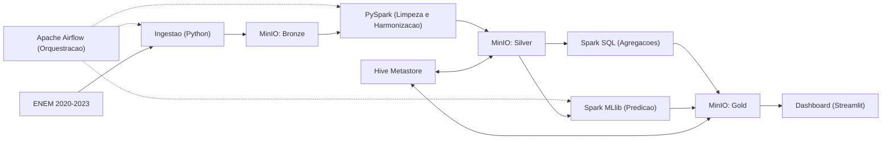

# Dados Massivos — Microdados do ENEM (2020–2023)

Repositório do trabalho final da disciplina **Processamento de Dados Massivos** (Ciência de Dados e Inteligência Artificial — PUC Minas).

- **Integrantes:** Gustavo Costa e João Paulo
- **Documento de caracterização e proposta:** [docs/caracterizacao_microdados_enem_2020-2023.pdf](docs/caracterizacao_microdados_enem_2020-2023.pdf)

---

## Objetivo do Projeto

Projetar e implementar um pipeline automatizado de Big Data, em arquitetura **Lakehouse**, para ingestão, harmonização e processamento distribuído dos Microdados do ENEM (2020–2023, ~6,88 GB descompactados e 16,58 milhões de registros), visando:

1. Consolidar a evolução da abstenção e do desempenho por área e redação no período pós-pandemia (2020–2023), segmentados por renda, raça/cor, sexo e trajetória escolar.
2. Construir um modelo preditivo distribuído em **Apache Spark (MLlib)** para estimar o risco de ausência dos participantes a partir exclusivamente de variáveis prévias à prova (perfil, escola, local e questionário socioeconômico `Q001–Q025`), identificando os fatores de maior peso.

---

## Arquitetura do Pipeline

### Camadas e Ferramentas

| Camada | Ferramenta | Papel na Arquitetura |
| :--- | :--- | :--- |
| **Orquestração** | Apache Airflow | Dispara e gerencia a DAG ponta a ponta (dependências, *retries* e logs). |
| **Ingestão** | Python (`requests` / `zipfile`) | Automatiza download e extração dos pacotes anuais do INEP para a camada **Bronze**. |
| **Armazenamento** | MinIO (S3 local) + Parquet/Delta | Organiza os dados nas camadas *Bronze* (bruto), *Silver* (limpo/harmonizado) e *Gold* (agregações e resultados de ML), particionados por `NU_ANO`. |
| **Catálogo** | Hive Metastore (+ PostgreSQL) | Expõe os arquivos Parquet/Delta do MinIO como tabelas SQL estruturadas (`enem_silver.*`, `enem_gold.*`). |
| **Processamento e ML** | Apache Spark (`PySpark`, `Spark SQL`, `MLlib`) | Limpa e harmoniza categorias entre edições, gera agregações analíticas e treina o modelo preditivo de risco de abstenção. |
| **Consumo** | Streamlit | Painel interativo conectado à camada **Gold** para visualização dos indicadores 2020–2023 e fatores de risco. |

### Fluxo Passo a Passo

1. **Ingestão (`Bronze`):** O Airflow dispara a coleta dos CSVs oficiais do INEP e armazena os arquivos brutos sem alterações no bucket `bronze` do MinIO.
2. **Limpeza e Harmonização (`Silver`):** Um job PySpark lê os CSVs da Bronze, trata tipos e encoding, harmoniza códigos que mudam entre edições (como `Q006` e `TP_ANO_CONCLUIU`), cria flags de abstenção e grava em Parquet/Delta na `silver`, registrando a tabela `enem_silver.participantes` no Hive Metastore.
3. **Agregações Analíticas (`Gold`):** Um job Spark SQL consulta `enem_silver.participantes` e gera tabelas agregadas por UF, ano, renda, raça/cor, sexo e rede escolar.
4. **Modelagem Preditiva (`Gold`):** Um job Spark MLlib treina e avalia classificadores (validação temporal: treino em 2020–2022 e teste em 2023) usando apenas atributos anteriores à prova para prever o risco de ausência, salvando métricas e importância das variáveis na camada `gold`.
5. **Consumo (`Streamlit`):** O dashboard lê as tabelas prontas da camada `gold` para exibição interativa.

---

## Estrutura de Branches

- `master`: versão estável / entregas consolidadas (recebe merge apenas de `develop`).
- `develop`: branch principal de desenvolvimento.

Consulte as regras obrigatórias de branches, commits, Pull Requests e testes de regressão em [AGENTS.md](AGENTS.md).
